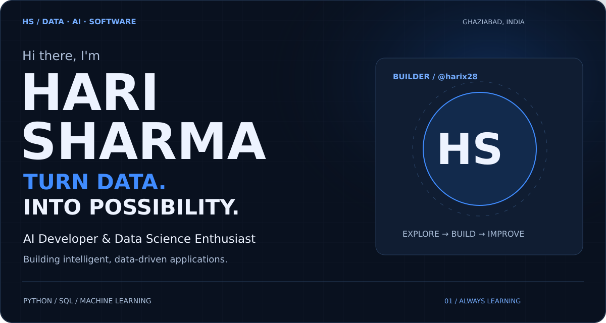
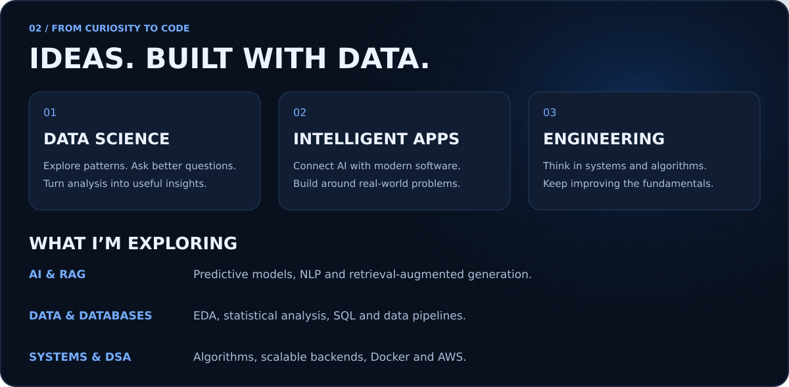
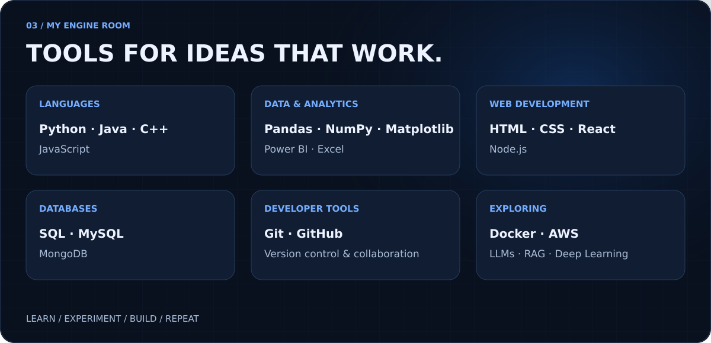
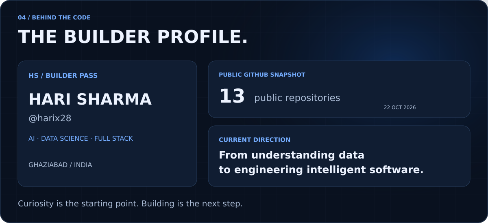
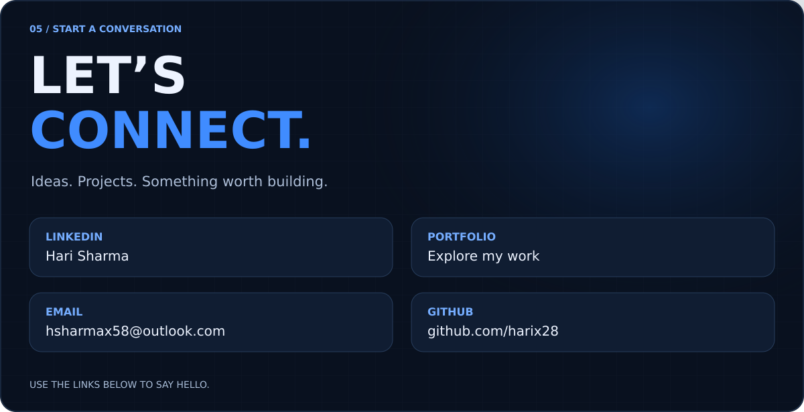

<!-- Upload README.md and the assets folder to the root of harix28/harix28. -->

  

### Things I've built

| Project | What it does | Focus |
| :--- | :--- | :--- |
| **RFM Customer Segmentation** | Explores purchasing behaviour and segments customers with Python and EDA. | Data Science + Analytics |
| **UIDAI Hackathon Insights** | Explores UIDAI datasets to identify patterns and useful insights. | EDA + Public Data |
| **Enterprise Sales Dashboard** | Multi-page Power BI report for exploring sales performance with DAX. | Business Intelligence |
| **Gov Connect** | A web platform connecting citizens with government resources and digital services. | Web Development |
| **FairFlat** | A housing application for finding, evaluating and managing flat listings. | Full Stack |
| [**Developer Portfolio**](https://harisharma-portfolio.vercel.app/) | My projects, skills and development journey in one place. | Personal Portfolio |

[Explore my repositories →](https://github.com/harix28?tab=repositories)

  <a href="https://www.linkedin.com/in/hari-sharma-73637a2b1">LinkedIn</a> &nbsp;·&nbsp;
  <a href="https://harisharma-portfolio.vercel.app/">Portfolio</a> &nbsp;·&nbsp;
  <a href="mailto:hsharmax58@outlook.com">Email</a> &nbsp;·&nbsp;
  <a href="https://github.com/harix28?tab=repositories">GitHub Projects</a>

Curious about data. Intentional about building.

